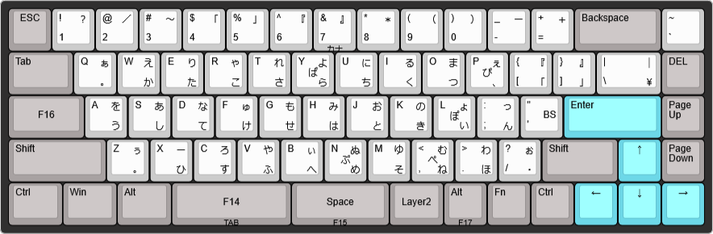

# SKYLOONG [GK68 Lite](https://skyloongtech.com/skyloong-gk68/ref/13/) 用 Nicola配列キーマップ
キーボード側で親指シフトをローマ字(※英字キー入力から仮名への変換方式)出力するためのキーマップです。  
物理的なキー配置はANSI配列で、Windowsの設定では日本語/日本語キーボード(106/109キー)配列で使用します。  
「」や『』・などは直接出力できませんから、MS-IMEなどの変換機能で確定します。

* 左親指キー : 単押し → 無変換キー 、長押し → TAB(変換候補)
* 右親指キー : 単押し → Spaceキー 、長押し → 変換キー

## 配列

## Nicolaモードの制御
本キーボードはhoboNicolaで使用している"observe_ime"を使うことを想定しています。 
Windowsのアプリ毎のIME状態がキーボードに反映されるので、いわゆるモードずれを気にする必要がありません。   

(1) 無変換キーでMS-IME側"IME on"、CAPSLOCKで"IME off"に切り替える。  
(2) "observe_ime"はIMEの状態からキーボードにNum Lockで通知する。  
(3) キーボードではNum Lockの状態に従ってNicolaモードをon/offする。  

## 制限事項
* Nicolaモードのとき、キーのリピートは効きません。
* 英語モードでANSIからJIS配列に変更した記号はリピートが効きません。

## 情報元
* https://github.com/okiraku-camera/observe_ime hoboNicolaで使用しているobserve_imeの情報です。
* https://skyloongtech.com/skyloong-gk68/ref/13/ GK68 Liteの購入先へのリンク
